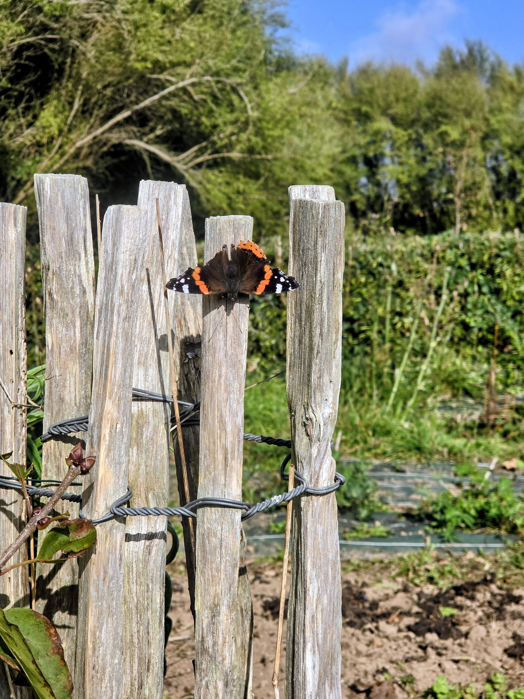
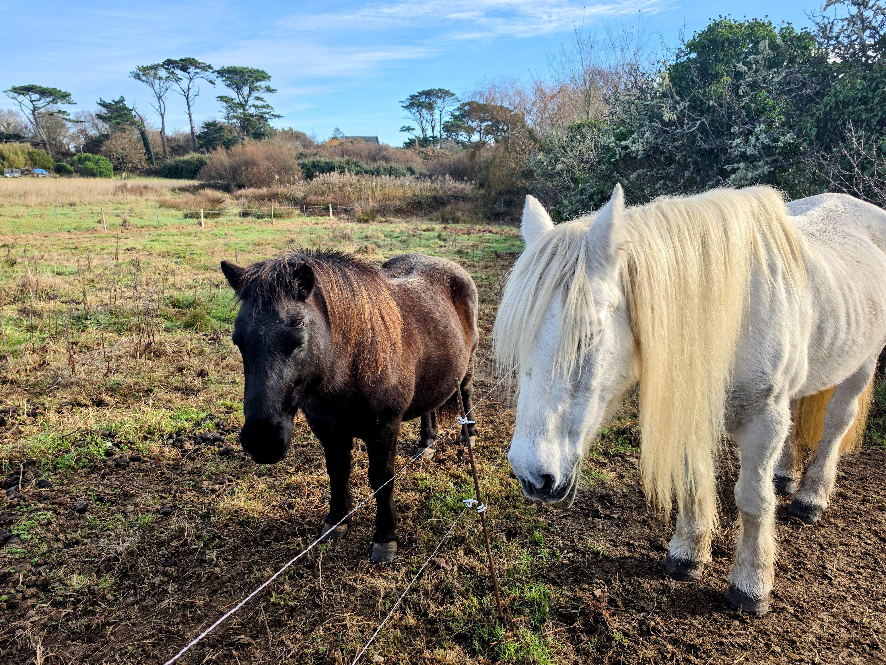

*Content Warning - mental health, light descriptions of heart problems*

I wrapped up my time on Marion's flower farm with a sense of heavy sadness.  I really loved it there - I loved the tranquility, the nature, the sound of the ocean always in the distance, the impossibly old buildings still operating as pubs, bakeries, and cafés.  I checked into an Airbnb in Brest, and my back suddenly decided to punish me for a week of hunching over, driving shovels into hard dirt, and stepping over fences.  Or, maybe not, as I'll get to below.  

I have a bad relationship with my back.  It goes out with enough regularity that it's always on my mind, but also with enough spontaneity to catch me by surprise and really ruin a day or two.  It's inextricably linked with my mental health as well.  My back goes out more often in times of stress, worry, or grief.  Leaving the farm was as likely a trigger as all of the physical labor.  I have the sense that, if offered, I would have happily stayed at the farm for much longer.  I grew attached to Joy and Flicka (the ponies), and even with the two sheep who wanted nothing to do with me.  And, I can't speak highly enough of Marion's family and how welcoming and loving they were.  I'm grateful not only for the hospitality, but also the fact that they trusted me - a total stranger - to help on their beloved land, and I sincerely hope I did a good job.  

I've debated for a while now whether to write about the intersections of this sabbatical with my mental health.  It's not that it's not important to me, but rather that I can't help but think that it's just not that interesting to read about.  I have a similar cocktail of mental health issues as many millennials, and I'd be lying if I said they didn't contribute to this whole crazy plan in both directions.  So, here it goes - an attempt to comparmentalize years of issues in a blog post, what could go wrong?

In 2018, I was hospitalized with a Staph infection that was initially misdiagnosed as the flu.  Two weeks in the hospital followed by eight weeks on IV antibiotics left some lasting effects, both physical (a tear in a heart valve that will never heal) and mental.  Soon into the recovery, I had symptoms consistent with PTSD - flashbacks to the hospital, phantom pain in my hip (where the infection decided to wreak its most memorable havoc), and shivers.  Cold weather, even all these years later, is one of the triggers for these symptoms, and the temperature here in Brest has gotten as low as 30 degrees (around 0 Celsius).  Then, rudely, the PTSD led to general anxiety, and the anxiety morphed into depression.  

Weirdly, depression is the one that really stuck.  It seems to me the farthest removed from the initial triggers, but it's unmistakable - periods of a serious lack of motivation and an inertia so heavy that simple tasks can occasionally fall by the wayside in favor of staying in bed, reading, playing video games, and - at its worst - doomscrolling.  In my very first sabbatical post, I remarked that I sent my intentions for a sabbatical year to my bosses on the very first day of school, both for my own benefit and for theirs.  It might be more accurate to say that it was for my depression's benefit, not my own, as I don't really consider that version of me to be, well, really me.  I think many people with chronic depression would agree that it often feels like you're always trying to stay one step ahead of this alternate self, like a really pathetic arms race towards a modicum of productivity.  

I'm not sure that I made the sabbatical decision totally conscious of the state of my mental health.  In the months following the decision, I would vacillate between total confidence in the choice and total confidence in giving up on it.  I'm sorry to say that, depending on when folks asked me how I was feeling about the trip, it's entirely possible that I lied to you, saying that I was "nervous but excited" when really I was "shitting my pants with terror" (metaphorically).  My colleagues would also often ask me if it felt weird to be coming in to teach every day while also planning for my travels, and, oddly, I think I had more reason to appreciate the routine and distraction of the daily grind.  Honestly, I think I was a pretty darn good teacher last year even while the emotional parts of my brain were doing daily war with whatever part is in charge of decision-making.  But that's the thing about depression - the places where we feel confident can be as good a treatment as any.  

When I arrived in Toulouse in August, I spent about 36 consecutive hours in the Airbnb.  I initially blamed it on jetlag, but I know it wasn't.  It was a run-of-the-mill depressive episode, triggered by the stress of leaving and confirmed by the fact that my hip hurt.  I know, I know - a long airplane ride can cause hip pain as well, and jetlag is certainly a debilitating effect of travel, but you'll have to trust me when I say that the pain wasn't physical.  It was my depressed self doing whatever it could to bring me down several notches.  Today, three months in, I type this knowing that there's plenty of cool stuff I missed out on in Toulouse, in Portugal, in Spain, etc.  I can chalk it up to platitudes like "pacing myself" all I want, but there's a huge difference between staying in bed all day because you're tired and doing it because anything else feels like lifting an elephant off of your chest.  

Before you sound the alarms, though, know that I'm truly, truly happy with where and who I am.  "Depressed and happy" might seem mutually exclusive, but they're not.  I've savored every moment of this trip's high points, and I've tried my best to learn from the low points.  I think having such a great experience on the farm only for it to end triggered the lowest point so far, which likely prompted this post. The romantic in me is saying that the current valley is giving me a better perspective on the peak I just descended from while the depressive in me just wants to go to bed.  

Pictured:  Depressed and Happy, Yin and Yang, Flicka and Joy (thanks to the ponies for their remarkably apt visual metaphor)

So, my time in Brest has, so far, been muted.  I've rested my back and my brain, and I've had enough motivation to visit Les Capucins with my WOOFF host family, a Breton cultural center constructed out of an erstwhile WWII arsenal with live music, shops, and a charming gondola (la téléferique) that shepherds folks across the river.  From Les Capucins, I got a good view of the city.  It lacks the old style European charm of other French cities I've been to, largely because it was nearly destroyed during WWII, and much of what was rebuilt has typified post-war modernism, for better and for worse.  It reminds me a little of cities I've seen in eastern Europe, especially Bratislava.  

I also had the opportunity to meet Violette, the niece of my French teacher colleague at Newton North, who is in Brest between missions for the French Navy where she serves as an Officer.  We met at a charming darts pub in the center city, and we had authentic Breton cider while chatting about our adventures.  Interestingly, she served a long stint in Réunion, and she offered me a ton of great advice for my upcoming visit there; we pored over maps of the island together, and she pointed out where it's dry, where it rains all the time, where to go hiking, where to get fresh lychee fruit.  It got me even more excited to spend a lot of time down there.  

I'm not entirely sure how to end this post (I know it's already too long - sorry).  I want to be sunny and reassuring - a real travel blogger mindset, but I also want to be honest above all else.  I operate under no delusion that anything I write is profound or important, and I hope you leave this post knowing a little more about me, about the context surrounding this trip, and about travel's intersections with mental health  in general.  And, if any of this resonates with you or mirrors your own experience with mental health, know that you and I will both be ok.  

