First off, a huge thank you to everyone who reached out after my last post.  It clearly resonated with people, and I got such lovely messages from a wide variety of people - folks I know well and folks who follow me just to read about the adventures of a nerdy teacher abroad.  I don't have words to express how great the feedback has been - so I'll just say thank you again. 

Since my last writing, quite a lot has happened.  I left Brest and made the long trek to Venice overland.  I could have gotten a flight, but taking the train is slightly more economical and far more beautiful.  My first stop was Paris, where I stayed the night and took advantage of the brief opportunity to walk around what is perhaps the most beautiful city in the world.  I have no real desire to spend more time in Paris, but being there is absolutely intoxicating.  You exit the train into the most beautiful station you've ever seen, then walk out to see the most charming and elegant streets.  Paris' power is undeniable.  Rather than fight my way through the metro system with all my bags, I decided to hoof it, walking about 3 miles from le Gare Montparnasse to my Airbnb, which was situated next to le Gare de Lyon, where my next train would take me off to Italy.  

Walking that distance with all my bags was simultaneously good for my mental health and bad for my physical health, as my back is still griping at me, and I certainly did it no favors.  But, I'm glad I did.  I walked by the entrance to the Paris Catacombs, by the Pantheon, saw several of the towering gothic cathedrals (but not Notre Dame), and crossed the Seine right at sunset.  

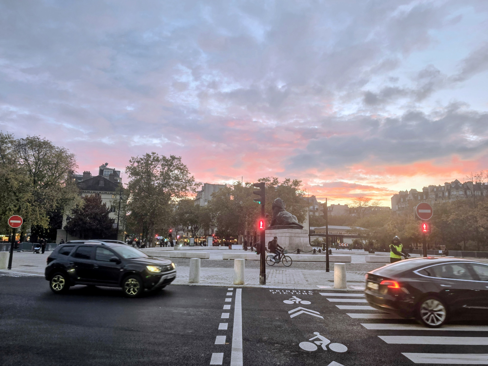

After my one night stopover, I took a train all the way to Milan, then narrowly made my connection to Venice, where I saw my parents for the first time since August 1st.  They had just wrapped up a trip to the Veneto region, which brought them to the Dolomites, Venice, and several charming villages and villas in the area.  They had a blast.  For our weekend together, we chose Trieste, a fascinating city about an hour and a half east of Venice that acts as a sort of gateway between western and eastern Europe.  We went on two tours, a walking tour of the city with a terrific local guide and a self-guided tour of Miramare Castle.  The city contained a mélange of cultural influences from its days under the rule of Austria as well as its newfound status as an Italian port.  Simply beautiful.  My parents treated me to some outstanding Italian food, graciously made room in their luggage to take home some small items I want to keep but worry about losing over my travels (including my half marathon medal from Bilbao), and put me up in a *very* fancy hotel for the weekend - certainly a big departure from my more humble lodgings.  

After saying goodbye, I made my way back the same way I came, as I had another farm stay about to begin.  Because of a scheduling conflict, I had to change trains in Modane, which I swear was a ploy to drum up more tourism for the French Alps, as I was treated to spectacular views of the mountains as I (and hundreds of other passengers) tried to negotiate the train transfer.  

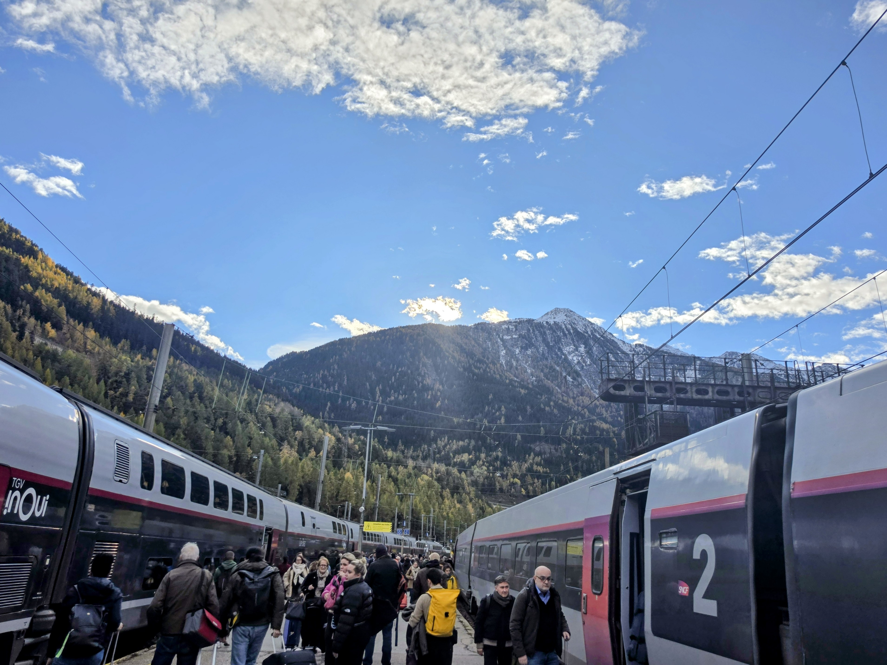

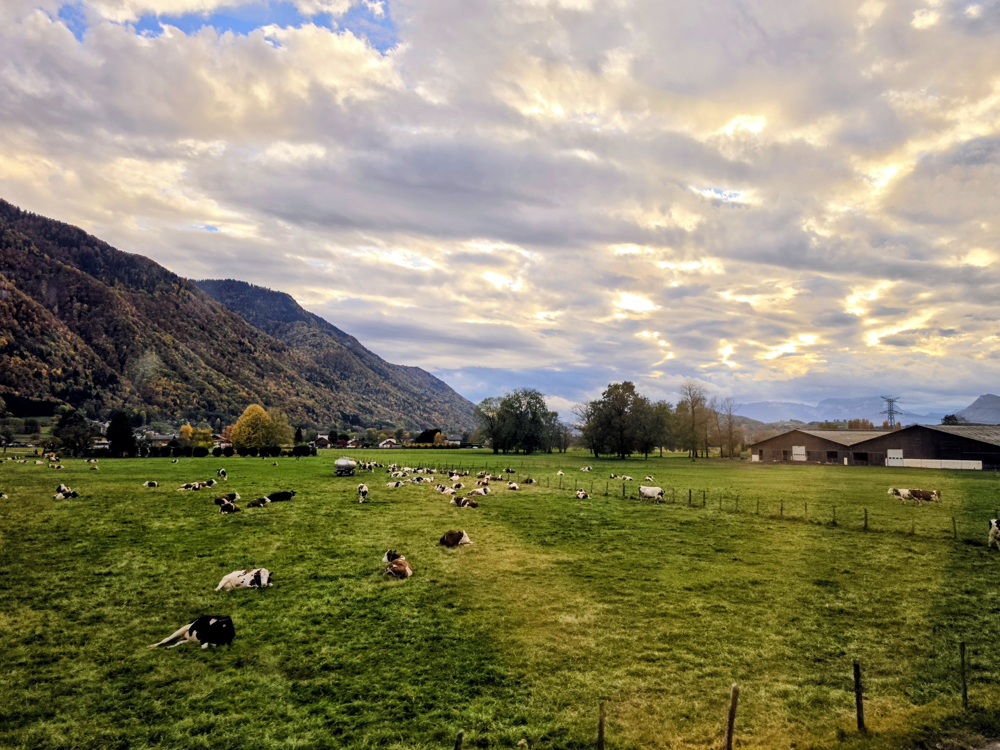

I arrived back in Paris for a quick layover before an overnight train to Toulouse, where I quickly embarrassed myself by getting fully situated in the wrong "couchette" (a small bed in a somehow smaller compartment) before hurriedly and apologetically ceding it to its rightful owner.  Once correctly installed in my compartment, I actually slept like a rock on the train, which was lucky considering the full day that awaited me in Seysses, the small farm village about a half hour south of Toulouse that contains Mariachage Moulas, a 3-hectare farm that organically grows every vegetable under the sun and then some.  

Alex and Nico, the owner and agriculturist of Moulas respectively, immediately took advantage of the extra set of hands, and I spent the full day in the fields, picking hundreds of kilos of squash, beans, onions, potatoes, carrots, radishes, turnips, bok choy, mizuna, rocket (arugula), and surely more (my memory couldn't possibly hold it all), followed by a thorough preparation of a separate field that is being turned over for the following season.  Nico showed me everything with clarity and a clear love for the land, and Alex cooked me an outstanding lunch with vegetables harvested less than an hour prior to their preparation.  I dined with Alex, Nico, and Alex's dad and uncle, a decisively old-school bunch of curmudgeonly charming agriculturists.  They were fascinated to hear about my travels and my experiences growing up in the US, and they didn't shy away from political topics, which I was more than happy to oblige.  I've come to really look forward to these lunches, both for the food and the camaraderie.  

I made bouquets of multi-colored carrots and spring onions.  I fed the neighbor's pony by hand.  I flexed my math-teacher muscles with some quick vegetable volume calculations.  And, at the end of the first day, Alex handed me a wooden crate and told me to fill it up with whatever I wanted.  I tried to respect the hard work that went into the getting the produce from field to fridge, but Alex had none of it, doubling and tripling whatever I chose to put in the crate, including giving me a dozen eggs laid that very morning.  Oh man, it's good (I'm munching on a bright yellow carrot as I write this).  

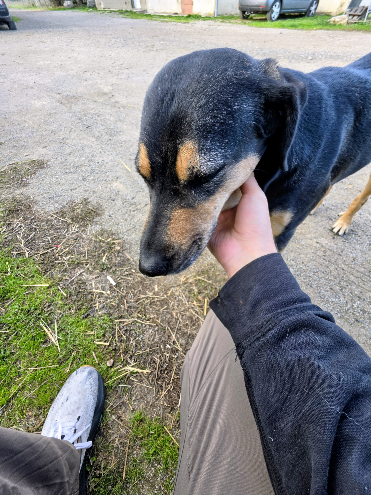

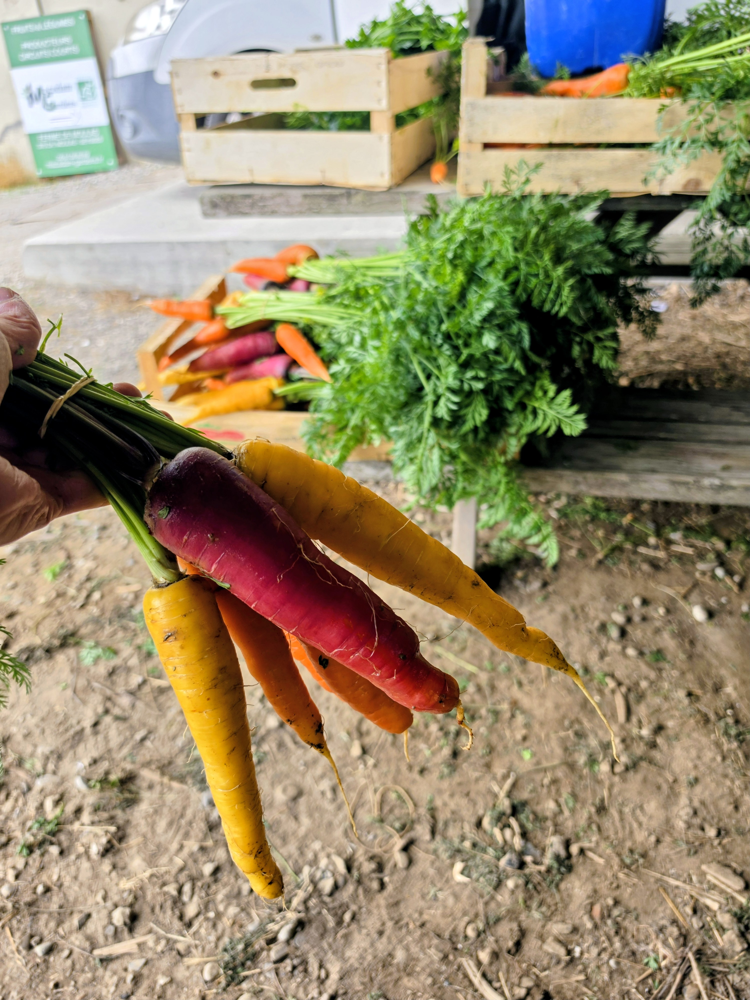

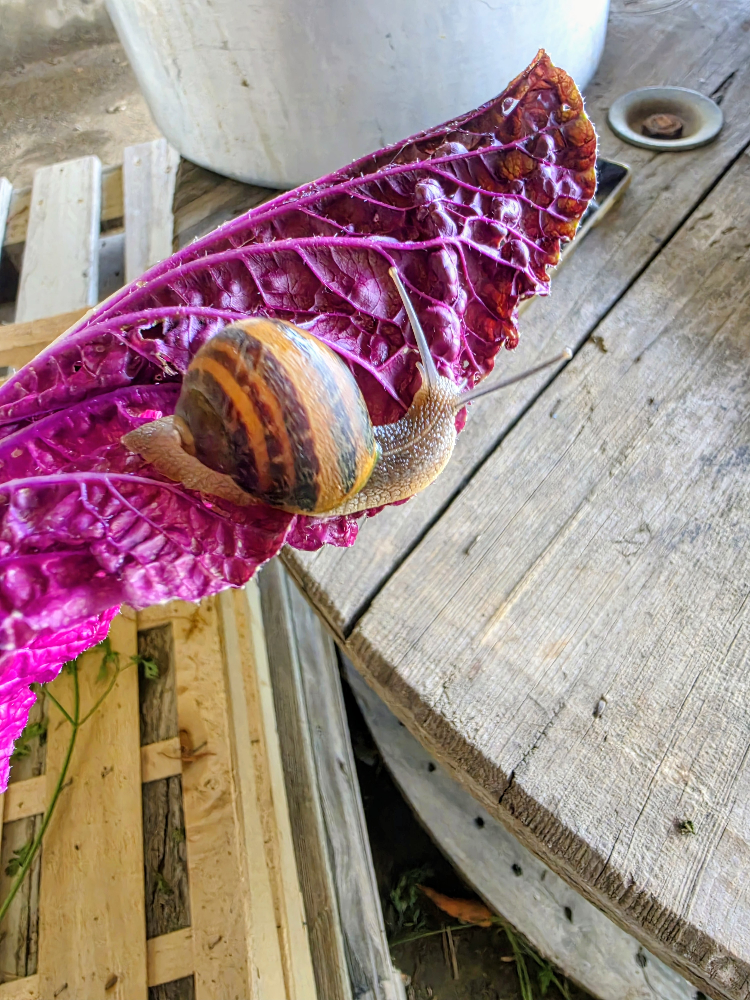

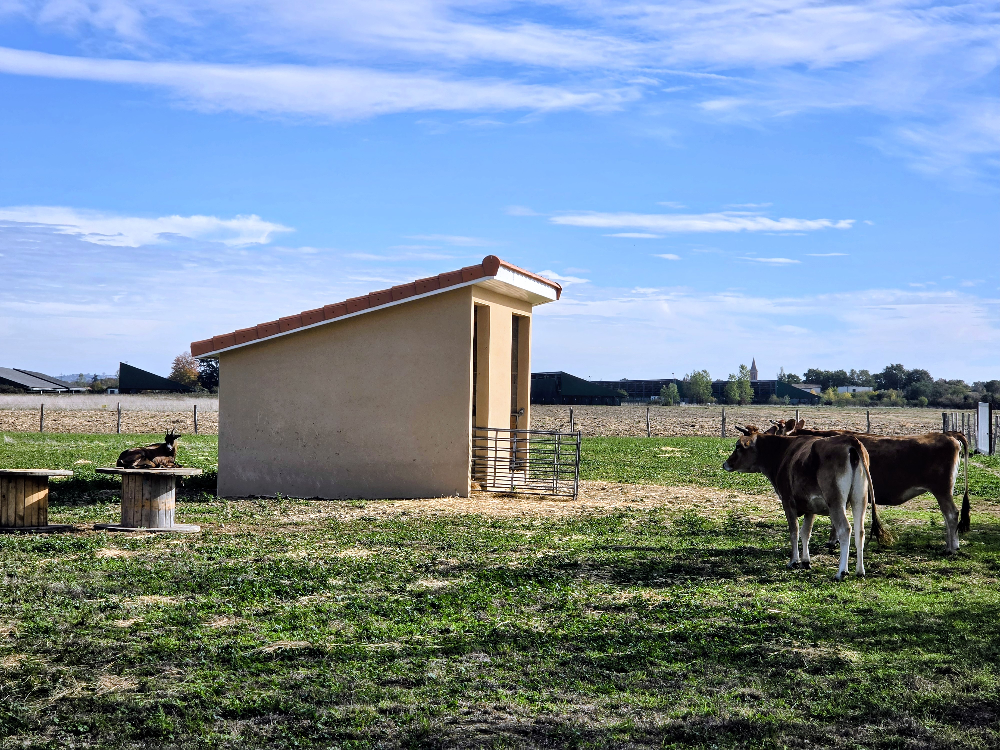

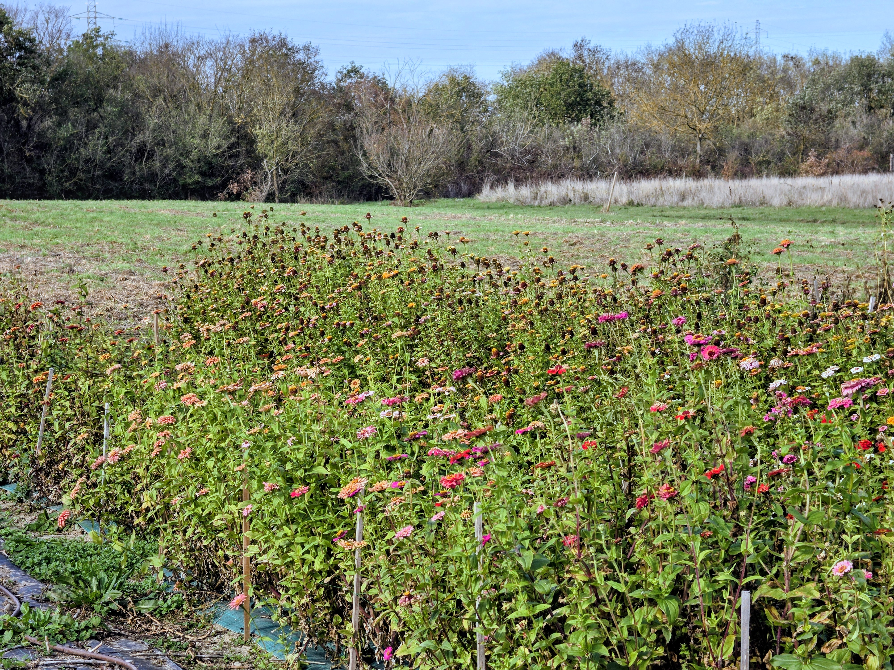

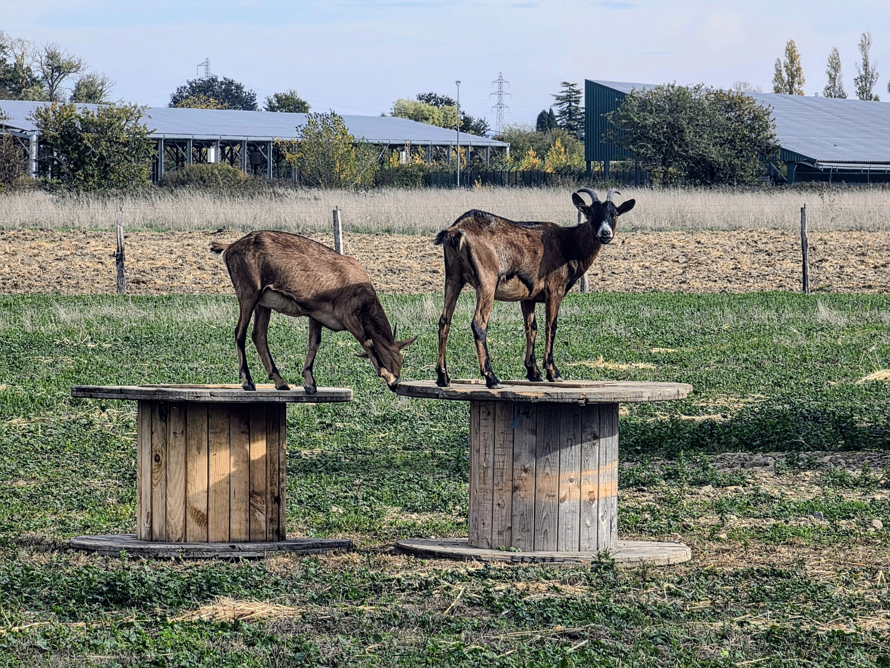

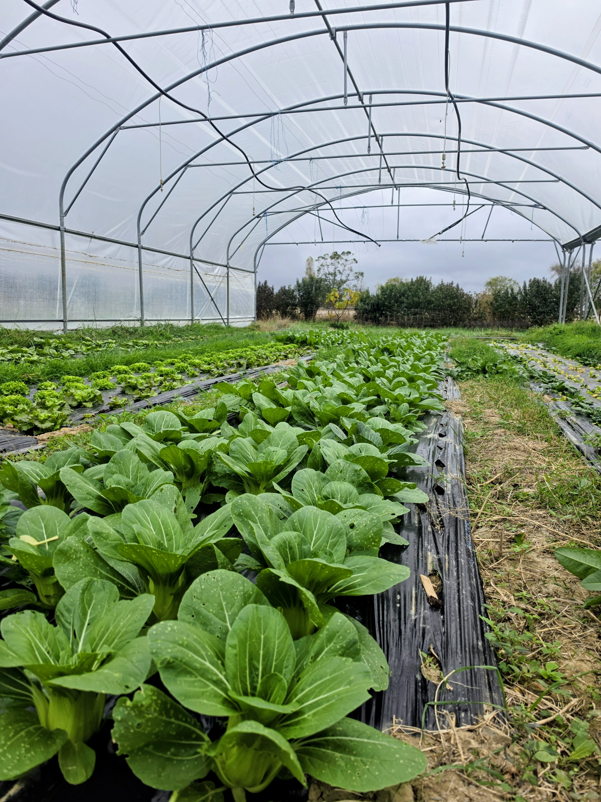

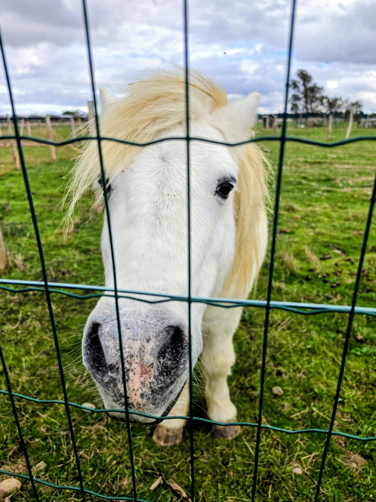

I also sojourned into Toulouse to see my friends I met in August.  We did trivia (I'm rusty - we came in 4th) and caught up.  Coming back to Toulouse has felt in many ways like coming home.  It's refreshing to find myself in familiar neighborhoods, able to navigate and knowing what to expect.  I'll say much more on this in my next post, where I'll have far less recapping to do and far more reflecting.  

For now, enjoy the above photos! I assure you that they don't fully capture the spirit and warmth they bring in person, but they'll have to do for now. 

Ethan
