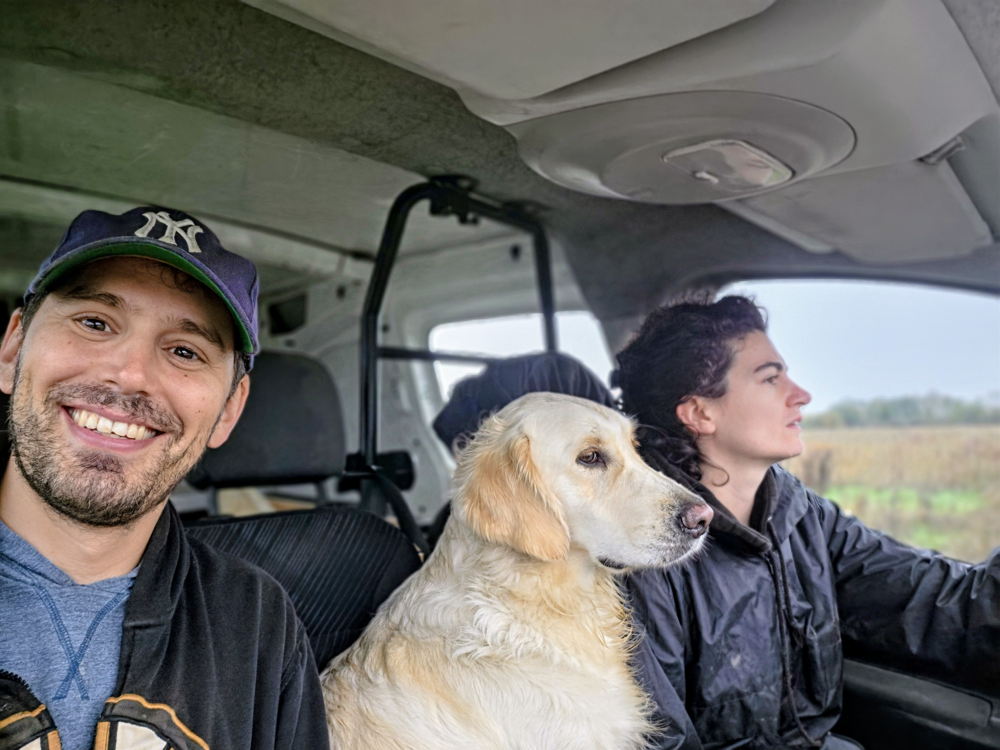
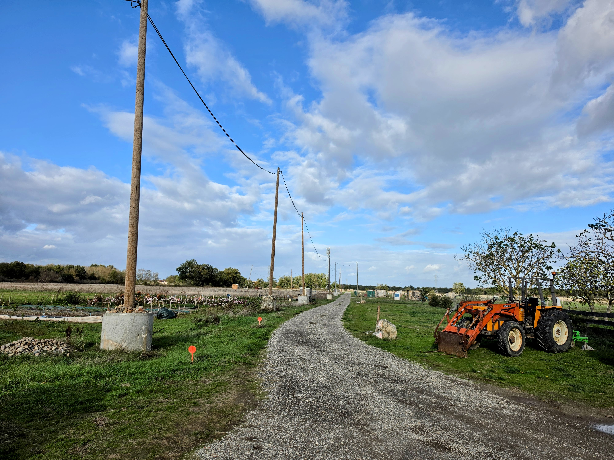
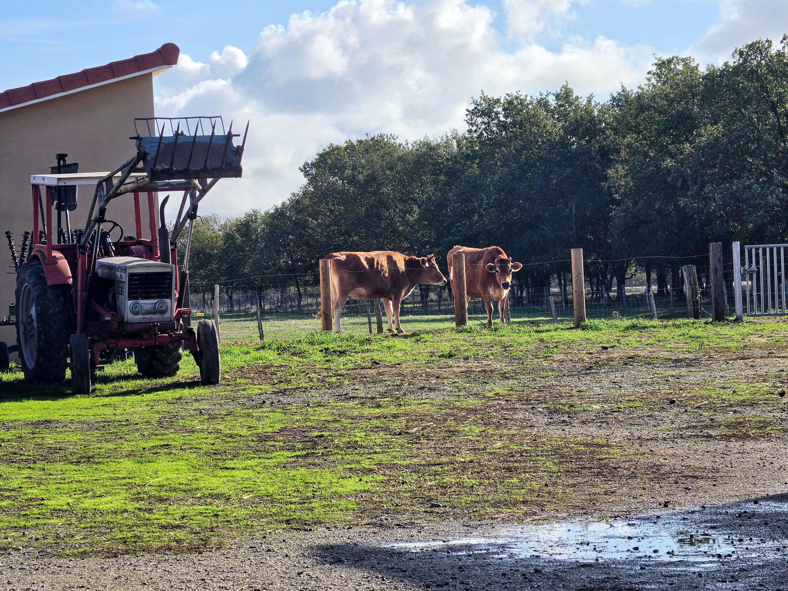
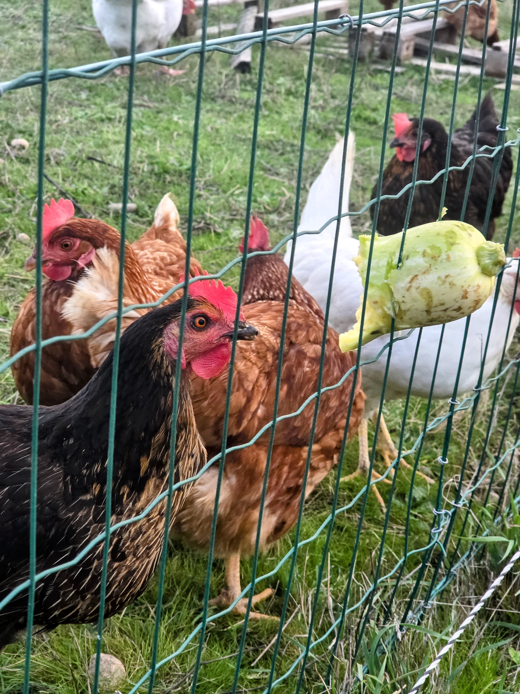
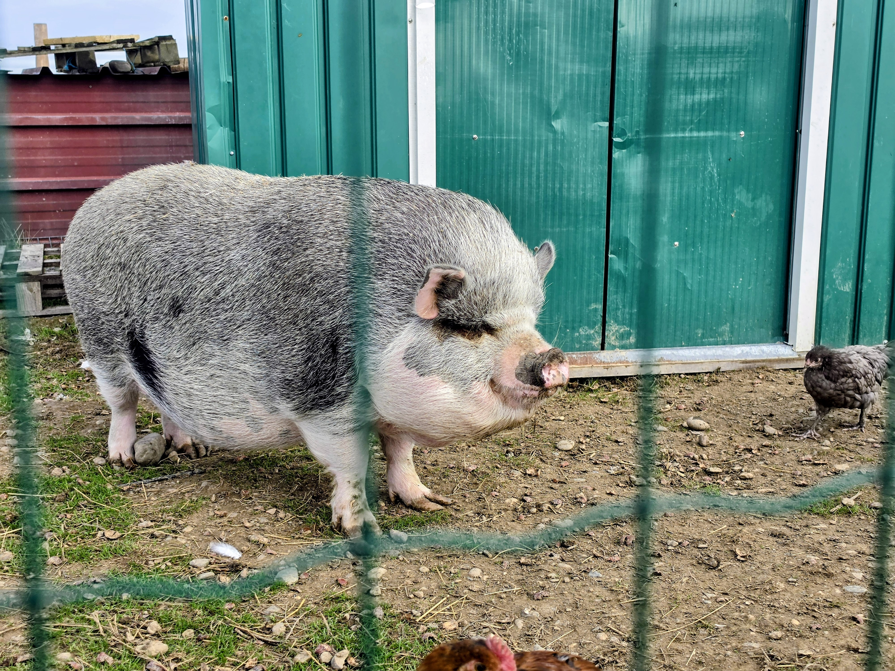
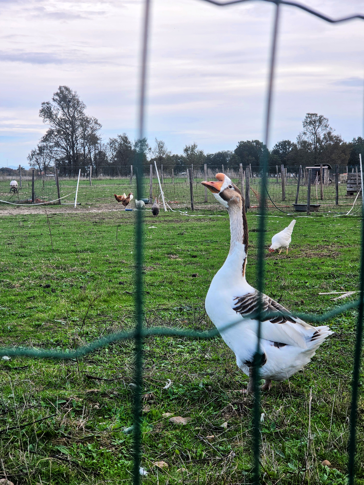

I'm sitting in a little kebab shop in Seysses, the farming community where I've been living and working for two weeks now, the rain pounding heavily outside.  I've been repeating seemingly nonstop that time moves differently in these little villages.  The work days go by lightning fast - or maybe it's more that everything takes a little bit longer than expected.  I've spent three days per week on the farm, turning up bright bouquets of carrots and sweet potatoes, searching through the long broccoli rows for specimens ready to be steamed, sauteed, or baked, shoving garlic cloves into the dirt so that only their little hats poke through.  I wielded a machete for a few hours, hacking away at the twisting vines of sweet potato plants, feeling like Indiana Jones the whole time. 

Mathilde and I on our way to harvest with a very important helper

At the end of every work day, I load up a wood crate with fresh vegetables, fruits, and eggs from the day, most of which were in the dirt only that morning.  Back at the guesthouse where I'm staying, I've made pasta with homemade sauces, fried rice with farm fresh eggs, and chicken stew.  I used a Tupperware to trap the most massive spider I've ever seen, returning it back to the nearby woods (and far, far away from me).  I'm happy I didn't kill it, both as a matter of principle (spiders are our friends) and because this one was so big that I think its family would hold a grudge, and I'm not risking that.  I've taken advantage of the poor internet connection by staying off it.  

I've day-tripped into Toulouse quite a few times now, including on the day of a protest, where I saw the joyful and sometimes stressful culture de manifestation (protest culture) up close, including songs, chants, creative signs, and some burning garbage cans.  I also saw a police presence larger than I ever would have expected in Europe, with the gendarmes out in full force with big riot shields, armored trucks, and, most notably, not a single gun in sight.  

Also in Toulouse, I visited a free art gallery/workshop that showcased a huge range of works across a sprawling, five-story warehouse.  I was struck by how many families with young kids were there too, even though, to my fragile American sensibilities, the art was certainly not kid-friendly.  It's no wonder that the French all seem so cultured to my eyes, when they've been spending their Saturdays at free art exhibits amidst (mostly) nonviolent social upheaval since toddlerdom.  

When I think about the last couple of weeks, the word that comes most to mind is "rhythm".  There's a steady beat that folks seem to march to both here in Seysses and within the wider limits of Toulouse.  Whether its the drumming of the fourchette into the dirt to pull up tubers, the chopping of vegetables, or the snare accompanying the march towards justice in the city streets (do you hear the people sing?), people here have purpose, intent.  

After months of traveling nonstop, staying no more than 10 days in any one place at a time, the steadiness of these last couple of weeks has been nothing short of reinvigorating and re-energizing.  Oddly, I've felt the most stabilized while up to my ankles in slick mud.  It might just be the effect of time, but I think it's also the culture here:  steady, purposeful, grounded. 

At the beginning of the week, our little team on the farm grew by one member - a 16-year-old who attends a local agricultural high school.  He's here to get job site experience as a part of his program, something I find incredibly cool and useful.  I'm sure that something like this exists in the more rural areas of the US, but it certainly never made its way to my little corner of Connecticut, nor am I certain that I would have been smart enough to take advantage of it were it presented to me. I can see in his eyes and actions all of that hesitancy that comes with being 16, and I'm struck by how similar he and I are, even separated by 20 years. He's incredibly shy; we invite him every day to eat lunch with us, but he tells us that he prefers to eat alone, which resonates with me.  I often see him having his lunch by the large chicken coop, tossing bits of lettuce to impatient beaks.  I honestly don't blame him for refusing his place at the table with us "olds" - he's clearly in his element around animals, and they do make for entertaining lunch company.  Or, at least, more entertaining than the geopolitical conversations that we inevitably meander into over our post-lunch bread, cheese, and coffee.  We both feel a little out of our depth, a little scared of making a mistake, and a little reluctant to take initiative - to take the leap rather than wait for instructions.  It feels like a huge win when I get a smile or a chuckle out of him; I like people who make me earn their honest reactions rather than humoring me.  

Where he and I differ, though, is that I've learned to ask for help, to embrace what I don't know, and be comfortable with learning.  Where's the best place to cut this broccoli? What does a good head of pe-tsai (a giant Chinese purple cabbage) look like? How deep should this spinach be planted? All questions that I asked at one point or another and saw him struggle with.  And of course, seeing him struggle and learn has put me right back in teacher mode, for better and worse.  And, it should be said, this kid is smart.  He rarely makes the same mistake twice, which I wish I could say about my experiences on the farm.  All told, he's added a different dimension to this experience for me.  I view him like a window through which I see my teaching experiences and a mirror reflecting my nervous adolescence right back at me.  

People often squint at me when I say that I'm introverted, but I fully identify as such:  I love to be around people when I'm in my element, and I need a lot of alone time to recharge and reflect.  I don't do great at parties where the fun is unstructured, but I feel right at home at a board game night, a session of D&D, dinner or drinks with someone I know well.  That's part of why this sabbatical felt like far more than travel to me - being out of my element so intentionally, forced to interact with strangers (in other languages, no less), without the home base of my condo, my close friends, my family (including, of course, Coco).  It's weird to write, but looking back on the experiences I've had so far, a bit less than halfway through this thing, I actually feel kind of proud of myself.  I knew my insecurities well before I left, and I made the leap anyway.  I don't think my French is advanced enough yet to impart any of this to my new friend on the farm, but I hope I can share some bits and pieces, to let him know that he's doing great, that these experiences are really good for him, and I'm proud of him, too. 

In the next few weeks, I'll say goodbye to this farm and hello to a different one close by.  By the middle of December, though, I'll leave Europe, first accompanying my mom on a 10-day tour of Morocco (!), then staying in Africa for longer stays in Senegal and South Africa. I'm excited for the next few chapters, but I'm not quite done with France yet - there's just too many sweet potato vines to clear first.  Where's my machete?  
